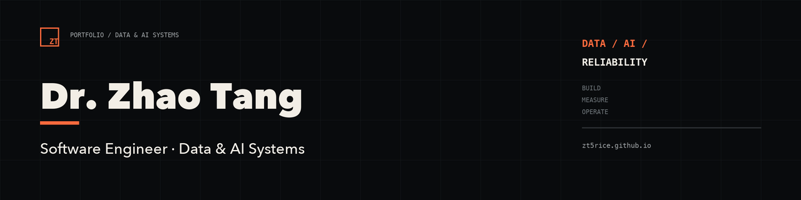

  

# Hi, I'm Dr. Zhao Tang 👋

**Software Engineer · Data & AI Systems**

I build reliable data platforms, measurable AI products, and production systems
that hold up under real load.

[Portfolio](https://zt5rice.github.io/) · [LinkedIn](https://www.linkedin.com/in/tzhao7-sde/) · [Email](mailto:ztangintuit@gmail.com) · [Resume](https://zt5rice.github.io/resume/Zhao_Tang_Resume_DataAI_2026-10-21.pdf)

## Current focus

- Reliable data platforms and real-time pipelines
- Retrieval, evaluation, and production AI systems
- Observability, incident response, and system reliability
- Reproducible research computing

## Selected work

| Project | What it does | Evidence | Links |
| --- | --- | --- | --- |
| **Clickstream** | End-to-end streaming platform from event ingestion to monitored read APIs | `~100 events/s` · `p95 181 ms` · `111 tests` | [Case study](https://zt5rice.github.io/work/clickstream/) · [Code](https://github.com/zt5rice/clickstream) |
| **GraphAtlas** | Multi-engine GraphRAG platform with citations and measurable retrieval quality | `0.840 Hit@5` · `537 ms p95` · `4.38/5 faithfulness` | [Case study](https://zt5rice.github.io/work/graphatlas/) · [Code](https://github.com/zt5rice/graphatlas) |
| **NL2SQLAgent** | Governed natural-language analytics with inspectable, read-only SQL | `1.03M rows` · `<250 ms queries` · `7–15 s LLM latency` | [Case study](https://zt5rice.github.io/work/nl2sqlagent/) · [Code](https://github.com/zt5rice/NL2SQLAgent) |
| **nanotrack** | Reproducible scientific video-tracking pipeline with orchestration and observability | `15 h → 30 min` · `6 publications` · `10k frames` | [Case study](https://zt5rice.github.io/work/nanotrack/) · [Code](https://github.com/zt5rice/nanoparticle-video-pipeline) |

## Technical toolkit

`Python` `SQL` `Spark` `Kafka` `Airflow` `dbt` `Databricks` `PostgreSQL` `ClickHouse` `FastAPI` `Docker` `Kubernetes` `Terraform` `AWS` `Prometheus` `Grafana` `TypeScript` `pgvector` `RAG / GraphRAG`

## About

My background spans computational imaging, machine learning, and research data
infrastructure. I completed a PhD at Rice University, where I built software for
complex scientific datasets and reproducible analysis. At Intuit, I moved into
real-time data platforms, customer-facing measurement, and production
reliability.

I care about the part after the demo works: correct data, observable systems,
measured outcomes, and clear boundaries between a portfolio build and
production traffic.

## Research

My research work supports **6 peer-reviewed publications**, with additional
conference posters and presentations.

[Google Scholar](https://scholar.google.com/citations?user=WlAErpUAAAAJ&hl=en)

## Let's connect

For roles, collaborations, or technical conversations about data platforms,
production AI, and reliability:

- [Personal website](https://zt5rice.github.io/)
- [LinkedIn](https://www.linkedin.com/in/tzhao7-sde/)
- [Email](mailto:ztangintuit@gmail.com)
